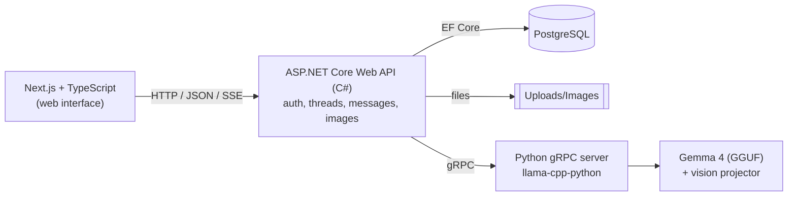

[READMEWebAPI.md](https://github.com/user-attachments/files/33969608/READMEWebAPI.md)
# AI Web Chat — a local LLM chat app with C#, Python and Next.js

A full-stack chat application that runs a vision-capable LLM (**Gemma 4**) entirely on your own machine. Register, log in, start conversations, attach photos to your questions, and come back to your chat history any time.

Built as a YouTube series: **"Building an AI Web Chat with C# and a Local LLM"**.


## Features

- User registration and login (JWT authentication, hashed passwords)
- Multiple conversations per user, with full chat history stored in PostgreSQL
- Image attachments: ask the model about a photo (JPEG, PNG, WebP)
- Streaming responses token by token (Server-Sent Events) as well as a standard request/response endpoint
- Everything runs locally: no external AI API, no data leaves your machine
- Each user can only see and modify their own conversations

## Architecture



| Part | Folder | Role |
|---|---|---|
| Web interface | _[webPart](https://github.com/Denys1209/ai-web-chat-webPart)_ | Login, register, chat UI, image upload |
| Web API | `LLM-Test/` | Accounts, JWT, threads, messages, image storage, talks to the model over gRPC |
| Inference server | `GrpcPythonServer/` | Loads the model and serves it over gRPC (unary and streaming) |
| Contract | `LLM-Test/proto/chat.proto` | Shared gRPC definition used by both servers |

**Why Python for the model and C# for the API?** The community fork of `llama-cpp-python` supports Gemma 4's vision handler, while the .NET wrappers I tried did not. gRPC lets each language do what it is best at, with a typed contract between them.

## Tech stack

- **Model:** `gemma-4-E4B-it-Q8_0.gguf` + `mmproj-F16.gguf` via [JamePeng/llama-cpp-python](https://github.com/JamePeng/llama-cpp-python)
- **Inference server:** Python, gRPC
- **API:** C#, .NET 9, ASP.NET Core minimal APIs, Entity Framework Core, Npgsql
- **Database:** PostgreSQL (UUIDv7 primary keys)
- **Auth:** `PasswordHasher<T>` (PBKDF2) and manually issued JWT bearer tokens
- **Frontend:** Next.js, TypeScript, shadcn/ui, Tailwind CSS

## Getting started

Tested on Windows 11. You need a machine that can run the model (a GPU helps a lot).

### Prerequisites

- [.NET 9 SDK](https://dotnet.microsoft.com/download)
- Python 3.11+
- PostgreSQL
- Node.js 20+ (for the frontend)

### 1. Download the model

From [`unsloth/gemma-4-E4B-it-GGUF`](https://huggingface.co/unsloth/gemma-4-E4B-it-GGUF) on Hugging Face, download:

- `gemma-4-E4B-it-Q8_0.gguf`
- `mmproj-F16.gguf`

Place both files in the `GrpcPythonServer/` folder.

### 2. Start the Python inference server

The official `llama-cpp-python` on PyPI does not include `Gemma4ChatHandler`, so install the prebuilt wheel from the fork's [GitHub releases](https://github.com/JamePeng/llama-cpp-python/releases) that matches your Python version and platform.

```bash
cd GrpcPythonServer
python -m venv .venv
.venv\Scripts\activate
pip install grpcio protobuf
pip install <path-or-url-of-the-JamePeng-wheel>
python server.py
```

Wait for `Server started, listening on 50051`.

If you change `chat.proto`, regenerate **both** stub files together, otherwise they get out of sync:

```bash
python -m grpc_tools.protoc -I../LLM-Test/proto --python_out=. --grpc_python_out=. ../LLM-Test/proto/chat.proto
```

### 3. Configure and start the API

`appsettings.json` is git-ignored because it holds secrets. Create `LLM-Test/appsettings.json`:

```json
{
  "ConnectionStrings": {
    "DefaultConnection": "Host=localhost;Port=5432;Database=aichat;Username=postgres;Password=YOUR_PASSWORD"
  },
  "Jwt": {
    "Key": "a-long-random-secret-at-least-32-characters",
    "Issuer": "AiChat.Api",
    "Audience": "AiChat.Client"
  },
  "AllowedHosts": "*"
}
```

Generate your own `Jwt:Key`; never reuse one you have shown publicly.

```bash
cd LLM-Test
dotnet run
```

The API listens on `http://localhost:5000`, and Swagger UI opens at `http://localhost:5000/swagger` in Development. The database tables are created automatically on first start. The API expects the Python server on `localhost:50051` and allows CORS from `http://localhost:3000`.

### 4. Start the web interface

```bash
cd <frontend-folder>
npm install
npm run dev
```

Open <http://localhost:3000>, register an account, and start chatting.

## API overview

| Method | Endpoint | Auth | Description |
|---|---|---|---|
| POST | `/api/auth/register` | no | Create an account, returns a JWT |
| POST | `/api/auth/login` | no | Log in, returns a JWT |
| GET | `/api/threads` | yes | List your conversations |
| POST | `/api/threads` | yes | Create a conversation |
| GET | `/api/threads/{id}` | yes | Get all messages of a conversation |
| DELETE | `/api/threads/{id}` | yes | Delete a conversation |
| POST | `/api/threads/{id}/messages` | yes | Send a message, get the full reply |
| POST | `/api/threads/{id}/messages/stream` | yes | Send a message, receive the reply as a Server-Sent Events stream |
| GET | `/api/image/{id}` | no | Fetch an attached image |

Send the token as `Authorization: Bearer <token>`.

## Project structure

```
ChatAI.sln
├── GrpcPythonServer/        # Python gRPC server wrapping the model
│   ├── server.py
│   └── chat_pb2*.py         # generated from chat.proto
└── LLM-Test/                # ASP.NET Core Web API
    ├── proto/chat.proto     # gRPC contract
    ├── Data/                # EF Core DbContext and entities
    ├── Dtos/                # request/response models + mapping extensions
    ├── Endpoints/           # auth, threads/messages, images
    ├── Services/            # AuthService, ThreadService, GrpcChatService, image services
    └── Extensions/          # DI, endpoint registration, validation
```

## Design notes

- **Passwords are hashed, not encrypted**, with `PasswordHasher<TUser>` used standalone, so the app keeps its own schema without pulling in full ASP.NET Core Identity.
- **The user's message is saved before the model is called**, so it survives if generation fails. On the streaming endpoint, a partial reply is still saved if the client disconnects.
- **Ownership checks** on every thread operation prevent one user from reading another user's conversations.
- **UUIDv7 primary keys** sort chronologically and index efficiently.
- **Manual DTO mapping** (`.ToDto()` extensions) instead of AutoMapper, to keep the code explicit.


## Watch the series

**[Building an AI Web Chat with C# and a Local LLM](https://www.youtube.com/watch?v=ekQtCD5E190&list=PLaiCi9FUe9uI&index=9)**


